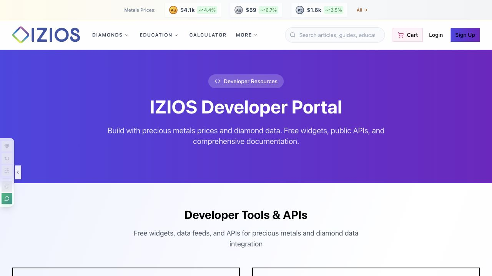

# Hypler

**Independent software engineering · AI infrastructure · Data platforms**

[Website](https://hypler.com/) · [Engineering references](https://hypler.com/wiki) · [Contact](mailto:contact@hypler.com)

I build software at **Hypler**, an independent software company based in Las Vegas. My work spans native applications, agent infrastructure, backend services, data pipelines, and the interfaces that connect them. I work through the full system: architecture, implementation, persistence, integration, validation, and operational handoff.

Several substantial projects are being built in the open. The repositories show the implementation, design decisions, contracts, and development history behind the work.

## IZIOS · Diamond Scout and commerce infrastructure

I build [**IZIOS**](https://hypler.com/projects/izios-diamond-platform), a lab-grown diamond commerce and data platform. The work connects supplier ingestion, normalized catalog records, product availability, search, customer interfaces, and reusable developer services. Its full application is private; selected integrations and widgets are published separately.

*Diamond Scout product illustration; conceptual artwork, not a search-result screenshot.*

### Diamond Scout: language, filters, and retrieval

[Diamond Scout](https://izios.com/diamond-scout) translates a buyer's request into a constrained search over diamond records. The implementation combines language-model query interpretation, structured filters, and semantic retrieval with **PostgreSQL and pgvector**. Exact stock or certificate references provide a separate lookup path. Results retain listing, certificate, and media links where available.

The engineering extends beyond a chat interface:

- **Individual stones and matched sets:** search supports single-stone requests and matching requirements for pairs and trios.
- **Availability-aware results:** buyer-facing projections exclude archived, unavailable, and held records rather than treating every ingested record as saleable inventory.
- **Separate ranking signals:** Scout relevance, LightScore, and SmartPrice are distinct signals rather than interchangeable guarantees.
- **Search refinement:** further refinement work is in launch preparation.
- **Clear decision boundaries:** discovery and comparison remain separate from purchase authorization and payment operations.

The latest refinement and integration work is in launch preparation; source implementation does not establish general availability.

### Agent access: MCP and WebMCP

Current development includes **Model Context Protocol (MCP)** access and a separate **browser WebMCP** interface. These expose buyer-facing discovery capabilities through defined tool contracts rather than giving an agent unrestricted application access.

The current MCP implementation defines three read-only tools:

| Tool | Purpose |
| --- | --- |
| `ask_diamond_scout` | Search public-facing diamond listings. |
| `get_diamond_answer` | Retrieve reviewed diamond-education answers. |
| `get_metals_data_access` | Discover metals-data access metadata, not live price quotes. |

Remote MCP access requires an authenticated session or approved credentials and remains subject to access controls. WebMCP is a distinct browser integration for search and comparison workflows. Neither interface grants payment, order-creation, or account-mutation authority. These integrations are being prepared for rollout; no universal client compatibility or launch date is claimed.

### Developer services and platform depth

The [developer portal](https://izios.com/developers) brings together diamond-data interfaces and metals resources. The public [OpenAPI document](https://izios.com/api/openapi.json) describes the public diamond API. The [Precious Metals Widgets](https://github.com/hypler-dev/izios-precious-metals-widget) repository provides MIT-licensed JavaScript embeds for gold, silver, platinum, and palladium displays and historical charts. Market-data rights and attribution remain separate from the widget code license.

*Existing public case-study capture of the developer portal; not a depiction of the latest launch interface.*

The application stack includes **React, TypeScript, Vite, Node.js, Express, PostgreSQL, Drizzle, and pgvector**. Work spans incremental synchronization, relational constraints, source-aware availability, vector retrieval, customer-facing search, administrative review, and commerce boundaries. The June 2026 public case study documents **more than 1.8 million active and archived records across catalog history**. That historical count is not a current saleable-inventory figure.

## Building in the open

### [Rangoon](https://github.com/hypler-dev/rangoon)

A local-first desktop workbench for reusable AI capabilities. Rangoon organizes project instructions, skills, and workflows into versioned records that can be inspected, composed, compiled, and exported.

The implementation uses **Rust, Tauri 2, SQLite, and JavaScript/HTML/CSS**. Technical work includes immutable skill and workflow revisions, source provenance, deterministic instruction compilation, transactional persistence, backup and recovery, and explicit boundaries between the native host and renderer. Capability authoring works independently of external authorization providers.

### [LNSAT](https://github.com/hypler-dev/LNSAT)

An authorization and evidence engine for consequential agent actions. LNSAT separates what an agent can describe from permission to perform an exact operation and evidence of its outcome.

The source combines **Rust, TypeScript, and SQLite** around a Gateway boundary. Work covers versioned action contracts, deterministic policy, scoped approvals, one-time authorization consumption, bounded execution-attempt records, durable receipts, and reconciliation of uncertain results. MCP, API, CLI, and application interfaces share the same authority model.

### [VUSL](https://github.com/hypler-dev/vusl)

An independent semantic interoperability specification and experimental **Rust core**, supported by **Python conformance tooling**. VUSL describes native source identity, semantic fidelity, translation loss, relationships, evidence, and uncertainty explicitly.

Its engineering work includes canonical bytes, scoped identifiers, immutable typed results, bounded parsing, independent conformance expectations, and meaning-preservation checks. VUSL develops independently of Rangoon and LNSAT; Rangoon is its planned first consumer.

**Rangoon, LNSAT, and VUSL are in development.** Their repositories track implementation progress, validation, and release status. Planned integrations and platform targets are documented separately from delivered support.

## Technologies and where I use them

| Area | Technologies | Engineering focus |
| --- | --- | --- |
| Native systems | Rust, Tauri | Typed core logic, process boundaries, lifecycle and local applications |
| Applications and APIs | TypeScript, JavaScript, Node.js, Express | Interface contracts, backend services, integrations and reusable APIs |
| Web interfaces | React, HTML, CSS, Vite | Customer tools, administrative workflows and inspectable technical interfaces |
| Persistence and retrieval | PostgreSQL, SQLite, SQL, pgvector | Transactions, revision history, normalization, structured and vector search |
| Validation and tooling | Python, Rust tooling, GitHub Actions | Independent conformance tools, reproducible checks and CI |
| Agent interoperability | MCP, versioned JSON contracts, protocol adapters | Capability composition, scoped authority, provenance and evidence |

## Engineering priorities

- **Explicit contracts:** typed boundaries, validated inputs, versioned protocols, and defined failure states.
- **Durable state:** transactions, immutable revisions, dependency-aware changes, and recovery paths.
- **Accountable actions:** permissions, approvals, attempts, receipts, and unknown outcomes represented as distinct facts.
- **Source-aware data:** preserve origin, update context, availability, and the limits of a retrieved result.
- **Reviewable delivery:** documented decisions, conformance fixtures, CI, independent review, and release evidence.

For platform development, systems integration, or engineering collaboration: **[contact@hypler.com](mailto:contact@hypler.com)**.
